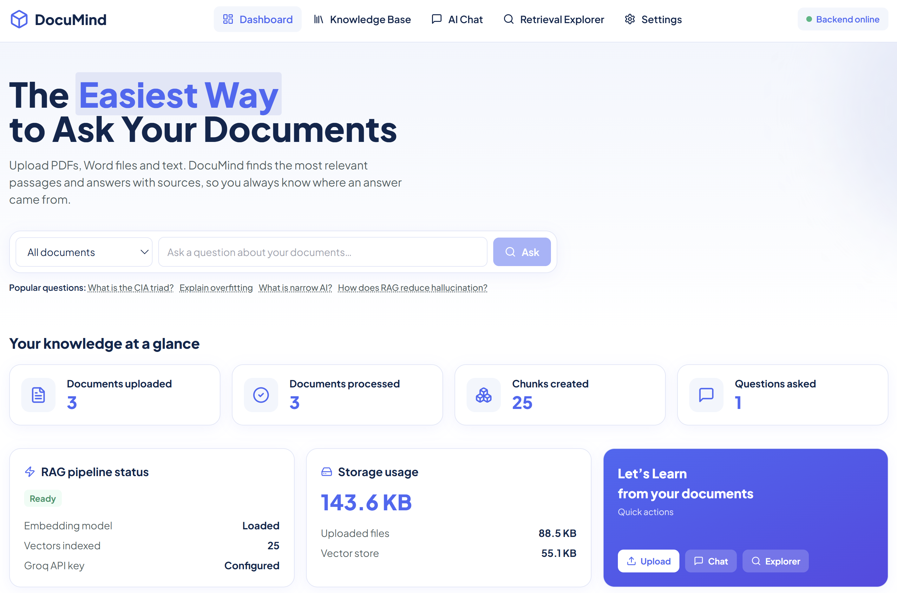
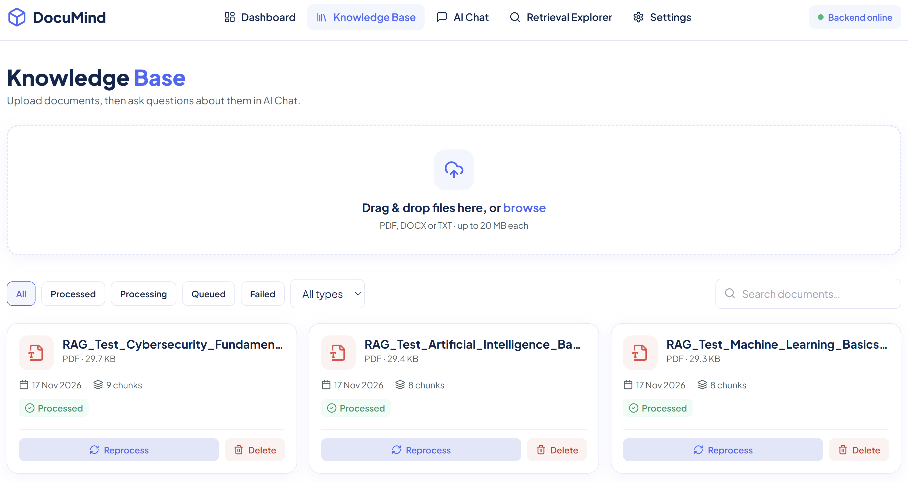
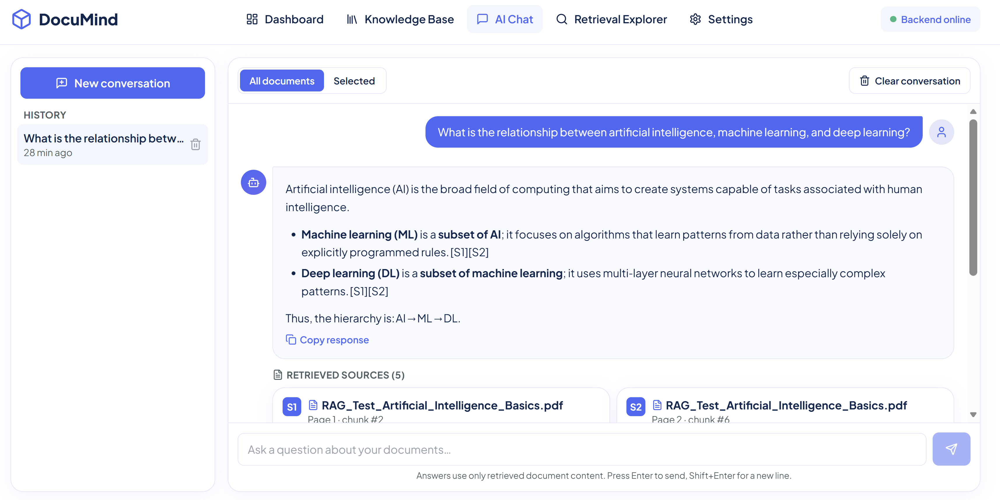
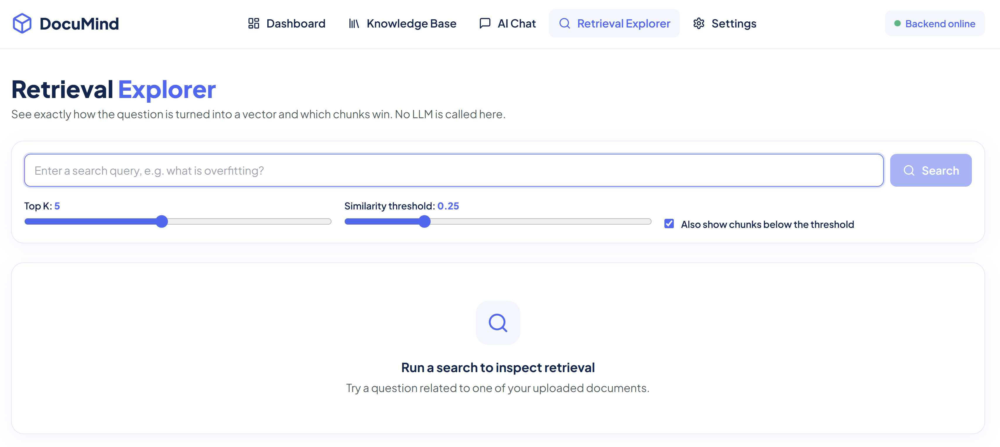
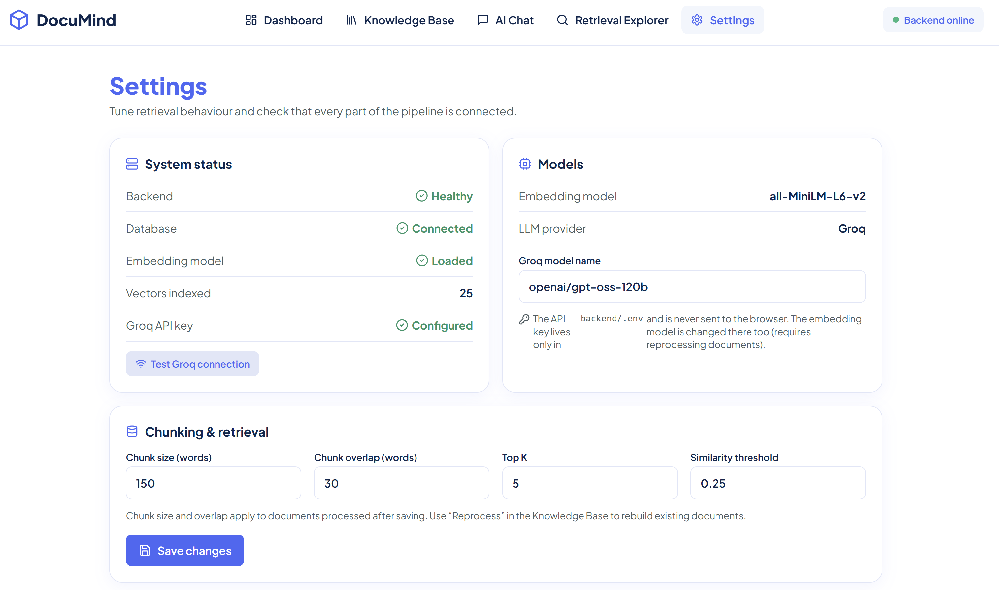
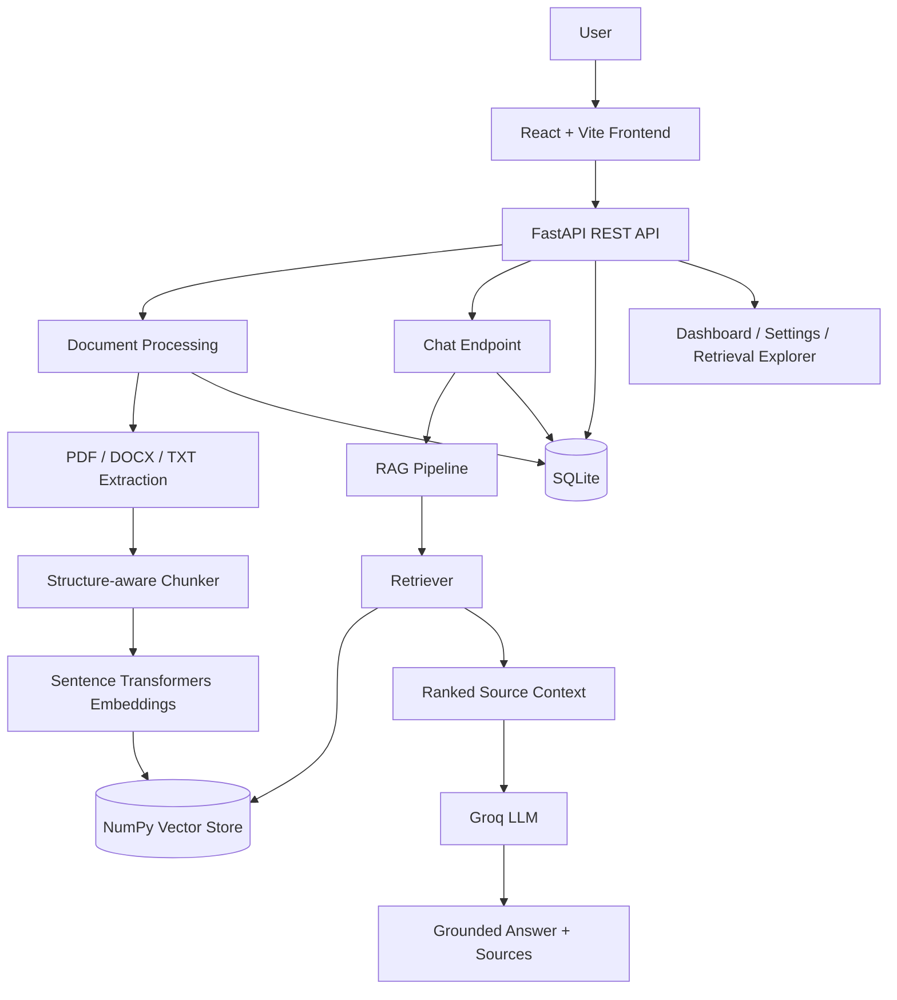

# DocuMind | RAG from Scratch

<p align="center">
  <strong>A transparent, document-grounded AI question-answering application built with a custom Retrieval-Augmented Generation pipeline.</strong>
</p>

<p align="center">
  
  
  
  
  
</p>

<p align="center">
  
  
  
</p>

---
## 📸 Application Screenshots

### Dashboard


### Knowledge Base


### RAG Chat Interface


### Retrieval Explorer


### Settings



## 1. Overview

**DocuMind** is a full-stack Retrieval-Augmented Generation (RAG) application that lets users upload PDF, DOCX and TXT documents, then ask questions grounded in the content of those documents.

Instead of sending a question directly to a language model, DocuMind first searches the uploaded knowledge base for relevant passages. The selected passages are supplied to the language model as context. Answers include source references so users can inspect where the information came from.

The core RAG stages are implemented directly in the project, without LangChain, LlamaIndex or an external vector database. This makes the system useful both as a practical document assistant and as a learning project for understanding how RAG works internally.

> **Project status:** The repository README supplied with this project notes that development was initially performed in an offline environment. Run the first-run checklist and tests in your environment before treating the application as production-ready.

---

## 2. Problem Statement

Large language models can generate fluent answers, but they may hallucinate and may not know the contents of private or newly supplied documents. Manually searching long documents is also time-consuming.

DocuMind addresses this by:

- Extracting text from user-provided documents.
- Splitting the text into searchable chunks.
- Converting chunks and questions into embedding vectors.
- Retrieving relevant passages using cosine similarity.
- Asking the LLM to answer using the retrieved context.
- Displaying source references with the generated answer.
- Returning an explicit insufficient-information response when the documents do not support an answer.

---

## 3. Key Features

### Knowledge Base

- Upload PDF, DOCX and TXT documents.
- Drag-and-drop upload interface.
- Upload progress feedback.
- Duplicate-file detection using SHA-256.
- Background document processing.
- Processing states: uploaded, processing, processed and failed.
- Search and filter the document list.
- Reprocess a document.
- Delete a document and its associated chunks and vectors.
- Maximum upload size configurable through backend settings.

### Custom RAG Pipeline

- Text extraction with page and section information where available.
- Structure-aware, sentence-aware chunking.
- Chunk overlap to preserve context across boundaries.
- Sentence Transformers embeddings.
- Custom NumPy vector store.
- Manual cosine-similarity calculation.
- Top-K retrieval and similarity threshold.
- Document-scoped retrieval.
- Candidate retrieval, duplicate removal and keyword/phrase re-ranking.
- Source-labelled context passed to the LLM.
- Grounded answers with `[S1]`, `[S2]` source references.

### AI Chat

- Ask questions about all processed documents.
- Restrict a question to selected documents.
- Conversation history.
- Markdown-formatted answers.
- Expandable source cards.
- Source document and page/section information.
- Clear response when the documents do not contain enough information.
- Groq-powered LLM responses.

### Retrieval Explorer

Inspect the retrieval process without calling the LLM:

- Enter a query and inspect retrieved chunks.
- View the expanded query.
- Inspect the embedding model and vector dimension.
- View the first values of the query embedding.
- View cosine-similarity scores.
- Adjust Top-K.
- Adjust the similarity threshold.
- Include results below the threshold to inspect near-misses.
- Read retrieval explanations.

### Dashboard

- Total uploaded documents.
- Processed document count.
- Total indexed chunks.
- Total questions.
- Upload and vector storage usage.
- Pipeline readiness.
- Embedding model status.
- LLM configuration status.
- Upload and question activity.
- Processing status distribution.
- Recent activity.

### Settings

- View backend and database status.
- Check embedding model status.
- Check indexed vector count.
- View whether the Groq API key is configured.
- Test the Groq connection.
- Configure chunk size and overlap.
- Configure Top-K and similarity threshold.
- Configure the Groq model name.
- Persist safe runtime overrides.

---

## 4. Technology Stack

| Layer | Technology | Purpose |
|---|---|---|
| Frontend | React 18 | User interface |
| Frontend tooling | Vite 5 | Development server and build |
| Styling | Tailwind CSS 3 | UI styling |
| Icons | Lucide React | Interface icons |
| Charts | Recharts | Dashboard visualizations |
| HTTP client | Axios | Frontend API requests |
| Routing | React Router | Client-side page routing |
| Backend | Python 3.12 | Application logic |
| API framework | FastAPI | REST API |
| ASGI server | Uvicorn | Backend server |
| Validation | Pydantic | Request and response schemas |
| ORM | SQLAlchemy | Relational data access |
| Database | SQLite | Document metadata and conversations |
| Embeddings | Sentence Transformers | Text embeddings |
| Embedding model | `all-MiniLM-L6-v2` | 384-dimensional semantic vectors |
| Vector storage | NumPy | Persisted vector matrix and metadata |
| LLM provider | Groq | Context-grounded answer generation |
| PDF extraction | PyMuPDF | PDF text extraction |
| DOCX extraction | python-docx | Word document extraction |

---

## 5. Architecture



### Main backend services

| Module | Responsibility |
|---|---|
| `document_processor.py` | Extracts and prepares uploaded documents |
| `text_chunker.py` | Splits document text into structure-aware chunks |
| `embedding_engine.py` | Loads the embedding model and generates normalized vectors |
| `vector_store.py` | Stores vectors and metadata, calculates cosine similarity and searches |
| `retriever.py` | Expands queries, retrieves candidates, filters and ranks chunks |
| `llm_service.py` | Builds grounded prompts and calls Groq |
| `rag_pipeline.py` | Coordinates indexing, retrieval, chat and source handling |

---

## 6. How RAG Works

### A. Document indexing

Indexing happens when a document is uploaded or reprocessed.

1. **Validate** the uploaded file type and size.
2. **Extract** text from PDF, DOCX or TXT.
3. **Preserve structure** such as PDF page numbers and DOCX heading sections where available.
4. **Chunk** the extracted text into smaller passages.
5. **Embed** each chunk using the configured Sentence Transformers model.
6. **Store** chunk metadata in SQLite and vectors in the NumPy vector store.

```text
Uploaded Document
       |
       v
File Validation
       |
       v
Text Extraction
       |
       v
Structure-aware Chunking
       |
       v
Embedding Generation
       |
       +------> SQLite: document and chunk records
       |
       +------> NumPy: vectors and metadata
```

### B. Question answering

1. The question is expanded where supported by the retrieval logic.
2. The same embedding model converts the question into a vector.
3. The vector store calculates cosine similarity against stored chunk vectors.
4. Candidate chunks are ranked and duplicate results are removed.
5. The configured threshold is applied to the original cosine scores.
6. Relevant source passages are assembled into labelled context.
7. The Groq LLM generates an answer using the supplied context.
8. The answer, sources and conversation messages are saved.

```text
User Question
      |
      v
Query Expansion
      |
      v
Question Embedding
      |
      v
Cosine Similarity Search
      |
      v
Candidate Ranking and Filtering
      |
      v
Source-labelled Context
      |
      v
Groq LLM
      |
      v
Grounded Answer + Citations
```

If no relevant context is found, the pipeline can return an insufficient-information response without calling the LLM.

---

## 7. Retrieval Accuracy Improvements

The project includes a retrieval accuracy update that addresses several issues found during testing and code review.

### Problems addressed

- Large page-based chunks could combine explanatory content with notes or suggested questions.
- The embedding model has a maximum input length, so oversized chunks could be silently truncated.
- Suggested-question lists could score highly for a query while not containing the actual explanation.
- Basic cosine-only retrieval could return weak or misleading matches.

### Changes included in the project

- Structure-aware chunking based on headings and paragraphs.
- Chunk sizes capped and checked against the embedding model tokenizer window.
- PDF extraction that preserves paragraph structure and detects headings using font size.
- Test-question and note chunks are identified and ranked after explanatory chunks.
- Candidate retrieval followed by duplicate removal.
- Similarity threshold applied to the original cosine score.
- Keyword and phrase re-ranking while retaining the original score.
- Abbreviation expansion for AI, ML, DL, NLP, LLM and RAG.
- Neighbouring text from the same section can be added to LLM context.
- Stronger grounding and prompt-injection handling.
- Embedding model and dimension consistency checks.
- Atomic vector index updates and re-indexing support.
- Detailed retrieval logging.

### Re-indexing existing documents

After updating an existing installation, stop the backend and frontend servers before replacing code or re-indexing.

From the `backend` directory:

```powershell
# Remove old saved runtime settings if they contain outdated chunk settings
Remove-Item storage\runtime_settings.json -ErrorAction SilentlyContinue

# Inspect current chunk data
python -m scripts.diagnose_retrieval --chunks

# Preview documents that will be rebuilt
python -m scripts.reindex --dry-run

# Back up and re-process documents
python -m scripts.reindex

# Inspect retrieval for a sample question
python -m scripts.diagnose_retrieval "What is Retrieval-Augmented Generation?"
```

The re-index script is designed to back up the database and vector data before rebuilding. Backups are stored under `backend/storage/backups/`.

To rebuild all documents after changing the embedding model:

```powershell
python -m scripts.reindex --all
```

---

## 8. Project Structure

```text
rag-from-scratch/
│
├── backend/
│   ├── app/
│   │   ├── main.py
│   │   ├── config.py
│   │   ├── database.py
│   │   ├── dependencies.py
│   │   ├── schemas.py
│   │   │
│   │   ├── models/
│   │   │   ├── document.py
│   │   │   ├── chunk.py
│   │   │   └── conversation.py
│   │   │
│   │   ├── routes/
│   │   │   ├── documents.py
│   │   │   ├── chat.py
│   │   │   ├── retrieval.py
│   │   │   ├── dashboard.py
│   │   │   └── settings.py
│   │   │
│   │   ├── services/
│   │   │   ├── document_processor.py
│   │   │   ├── text_chunker.py
│   │   │   ├── embedding_engine.py
│   │   │   ├── vector_store.py
│   │   │   ├── retriever.py
│   │   │   ├── llm_service.py
│   │   │   └── rag_pipeline.py
│   │   │
│   │   └── utils/
│   │       ├── file_validator.py
│   │       └── helpers.py
│   │
│   ├── scripts/
│   │   ├── before_after.py
│   │   ├── diagnose_retrieval.py
│   │   └── reindex.py
│   │
│   ├── storage/
│   │   ├── uploads/
│   │   └── vectors/
│   │
│   ├── tests/
│   ├── requirements.txt
│   └── .env.example
│
├── frontend/
│   ├── src/
│   │   ├── components/
│   │   ├── context/
│   │   ├── hooks/
│   │   ├── layouts/
│   │   ├── pages/
│   │   │   ├── Dashboard.jsx
│   │   │   ├── KnowledgeBase.jsx
│   │   │   ├── Chat.jsx
│   │   │   ├── RetrievalExplorer.jsx
│   │   │   └── Settings.jsx
│   │   ├── services/
│   │   ├── utils/
│   │   ├── App.jsx
│   │   ├── main.jsx
│   │   └── index.css
│   ├── package.json
│   ├── vite.config.js
│   └── .env.example
│
├── sample_documents/
│   ├── artificial_intelligence_fundamentals.txt
│   ├── cybersecurity_fundamentals.txt
│   ├── machine_learning_basics.txt
│   └── SAMPLE_QUESTIONS.md
│
├── .gitignore
└── README.md
```

---

## 9. Requirements

Install the following before running the project:

- Python 3.12 recommended by the project setup.
- Node.js 18 or newer.
- npm.
- A Groq API key for LLM-powered chat.
- Internet access for installing dependencies and downloading the embedding model on first use.

The embedding model is loaded and cached by the backend. The first run may take longer because model files need to be downloaded.

---

## 10. Backend Setup

Open PowerShell and navigate to the project:

```powershell
cd rag-from-scratch
cd backend
```

Create a virtual environment:

```powershell
python -m venv .venv
```

Activate it:

```powershell
.\.venv\Scripts\Activate.ps1
```

If PowerShell blocks script activation, run:

```powershell
Set-ExecutionPolicy -Scope CurrentUser RemoteSigned
```

Then activate the environment again.

Install dependencies:

```powershell
python -m pip install --upgrade pip
pip install -r requirements.txt
```

Create the environment file:

```powershell
Copy-Item .env.example .env
```

Open it:

```powershell
notepad .env
```

Configure the values described below.

Start the API:

```powershell
uvicorn app.main:app --reload
```

Backend base URL:

```text
http://localhost:8000
```

Interactive API documentation:

```text
http://localhost:8000/docs
```

---

## 11. Environment Configuration

In `backend/.env`:

```env
GROQ_API_KEY=your_groq_api_key
GROQ_MODEL=llama-3.3-70b-versatile

DATABASE_URL=sqlite:///./rag_database.db

EMBEDDING_MODEL=sentence-transformers/all-MiniLM-L6-v2

CHUNK_SIZE=150
CHUNK_OVERLAP=30
TOP_K=5
SIMILARITY_THRESHOLD=0.25

MAX_FILE_SIZE_MB=20
CORS_ORIGINS=http://localhost:5173

EMBED_MAX_WORDS=150
CANDIDATE_K=10
LOG_TEXT_CHARS=300
```

### Groq API key

1. Create or sign in to your Groq account.
2. Generate an API key in the Groq console.
3. Put the key in `GROQ_API_KEY` in `backend/.env`.
4. Restart the backend.

The API key is read by the backend only and is not returned to the frontend.

Groq may retire or rename models. If the configured model is unavailable, check the models currently available in your Groq console and update `GROQ_MODEL` or the model name in Settings.

Without a Groq API key, document upload, indexing and retrieval exploration can still be used. LLM-generated chat answers require a configured Groq key.

---

## 12. Frontend Setup

Open a second PowerShell terminal.

Navigate to the frontend:

```powershell
cd rag-from-scratch\frontend
```

Install packages:

```powershell
npm install
```

Create the optional frontend environment file:

```powershell
Copy-Item .env.example .env
```

The default API URL is:

```env
VITE_API_URL=http://localhost:8000
```

Start Vite:

```powershell
npm run dev
```

Open:

```text
http://localhost:5173
```

For a production frontend build:

```powershell
npm run build
```

To preview the build:

```powershell
npm run preview
```

---

## 13. Run Both Services

### Terminal 1: Backend

```powershell
cd rag-from-scratch\backend
.\.venv\Scripts\Activate.ps1
uvicorn app.main:app --reload
```

### Terminal 2: Frontend

```powershell
cd rag-from-scratch\frontend
npm run dev
```

Open the frontend:

```text
http://localhost:5173
```

---

## 14. Try the Sample Documents

The repository includes three sample documents:

- `sample_documents/artificial_intelligence_fundamentals.txt`
- `sample_documents/cybersecurity_fundamentals.txt`
- `sample_documents/machine_learning_basics.txt`

Upload these from the Knowledge Base page.

Wait until each document reaches the **Processed** state before asking questions.

Example questions are provided in `sample_documents/SAMPLE_QUESTIONS.md`.

Try questions such as:

- What is the difference between narrow AI and general AI?
- What are the three parts of the CIA triad?
- What is overfitting and how can it be reduced?
- Explain precision and recall.
- Which fields of AI are mentioned across the documents?

Also try an out-of-scope question, such as:

- What is the capital of France?

The expected grounded behaviour is to state that the uploaded documents do not contain enough information.

---

## 15. Application Pages

| Page | Route | Description |
|---|---|---|
| Dashboard | `/` | Document, chunk, question, storage and activity statistics |
| Knowledge Base | `/knowledge-base` | Upload, search, process, reprocess and delete documents |
| AI Chat | `/chat` | Ask questions and inspect cited sources |
| Retrieval Explorer | `/retrieval` | Inspect query embeddings, retrieved chunks and scores |
| Settings | `/settings` | Configure retrieval parameters and inspect service health |

---

## 16. API Reference

Interactive API documentation is available at:

```text
http://localhost:8000/docs
```

### Documents

| Method | Endpoint | Purpose |
|---|---|---|
| `POST` | `/api/documents/upload` | Upload a document and start background processing |
| `GET` | `/api/documents` | List documents; supports `q`, `status` and `file_type` filters |
| `GET` | `/api/documents/{document_id}` | Get document details |
| `DELETE` | `/api/documents/{document_id}` | Delete document, chunks and vectors |
| `POST` | `/api/documents/{document_id}/process` | Reprocess a document |

### Chat

| Method | Endpoint | Purpose |
|---|---|---|
| `POST` | `/api/chat/ask` | Ask a question about uploaded documents |
| `GET` | `/api/chat/conversations` | List conversations |
| `GET` | `/api/chat/conversations/{conversation_id}` | Get a conversation and its messages |
| `DELETE` | `/api/chat/conversations/{conversation_id}` | Delete a conversation |

### Retrieval

| Method | Endpoint | Purpose |
|---|---|---|
| `POST` | `/api/retrieval/search` | Run retrieval without calling the LLM |

### Dashboard

| Method | Endpoint | Purpose |
|---|---|---|
| `GET` | `/api/dashboard/stats` | Get document, chunk, question and storage statistics |
| `GET` | `/api/dashboard/activity` | Get upload, question and processing activity |

### Settings and health

| Method | Endpoint | Purpose |
|---|---|---|
| `GET` | `/api/settings` | Get safe public settings |
| `PUT` | `/api/settings` | Update supported runtime settings |
| `GET` | `/api/health` | Check database and pipeline health |
| `GET` | `/api/health?test_llm=true` | Also test the Groq connection |

API errors use a consistent response structure:

```json
{
  "error": {
    "code": 404,
    "message": "Document not found."
  }
}
```

---

## 17. Retrieval Settings

The main retrieval settings include:

| Setting | Default | Description |
|---|---:|---|
| `CHUNK_SIZE` | `150` | Target chunk size used by the configured chunker |
| `CHUNK_OVERLAP` | `30` | Overlap between adjacent chunks |
| `TOP_K` | `5` | Number of final chunks to retrieve |
| `SIMILARITY_THRESHOLD` | `0.25` | Minimum original cosine score |
| `CANDIDATE_K` | `10` | Candidate pool size before final ranking |
| `MAX_FILE_SIZE_MB` | `20` | Maximum accepted upload size |

The similarity threshold controls the precision/recall trade-off:

- A higher threshold is stricter and may reject relevant passages.
- A lower threshold can return more passages, including weaker matches.

Use Retrieval Explorer to inspect the returned chunks and scores before changing the threshold.

Chunk settings changed in the UI apply to documents processed after the change. Reprocess existing documents to rebuild their chunks and embeddings.

---

## 18. Run Tests

From the backend directory:

```powershell
cd rag-from-scratch\backend
.\.venv\Scripts\Activate.ps1
pytest -v
```

The test suite includes coverage for:

- PDF, DOCX and TXT extraction.
- Empty and corrupted documents.
- Chunking.
- Cosine similarity.
- Vector store operations.
- Retrieval ranking.
- RAG pipeline behaviour.
- Prompt-injection containment.
- API endpoints.

The tests use a fake embedder and mocked LLM for most test cases, so they do not require a live Groq API key or a model download.

A real-model retrieval test is skipped by default. To enable the real embedding model retrieval test in PowerShell:

```powershell
$env:RAG_TEST_REAL_MODEL="1"
pytest tests\test_retrieval_accuracy.py -v
```

Run tests in your own environment and review any failures before presenting or deploying the project.

---

## 19. Security Considerations

The project includes several defensive measures:

- Upload file type and size validation.
- Sanitised upload filenames.
- Files stored under generated identifiers.
- Path traversal protection.
- Configurable CORS allow-list.
- API keys stored in backend environment variables.
- API key excluded from public settings responses.
- Retrieved document text treated as untrusted input.
- Prompt rules instructing the LLM not to follow instructions found inside uploaded documents.
- Context closing-tag neutralisation.
- Model and vector dimension consistency checks.
- Atomic vector index writes and document replacement.

Prompt-injection protections reduce risk but cannot guarantee complete prevention. Do not treat this local learning project as a hardened multi-user production service without additional security review.

---

## 20. Known Limitations

- The application is designed for local, single-user use and does not include user accounts or authentication.
- The NumPy vector store uses brute-force similarity search and is intended for small to medium collections, not millions of chunks.
- Scanned PDFs containing only images are not OCR-processed and may be rejected when no text is extractable.
- Complex tables and document layouts may be flattened during extraction.
- Changing the embedding model requires re-indexing all documents.
- Chunk setting changes apply to newly processed documents until existing documents are reprocessed.
- Document processing runs in the backend process. If the server stops during processing, the document is marked failed and can be reprocessed.
- The latest six chat messages are used as history.
- Each question is retrieved independently; query rewriting for multi-turn follow-up questions is not implemented.

---

## 21. Troubleshooting

### Backend cannot start

Confirm that the virtual environment is active and dependencies are installed:

```powershell
pip install -r requirements.txt
uvicorn app.main:app --reload
```

### Frontend cannot reach the backend

Check that the backend is running at:

```text
http://localhost:8000
```

Check `frontend/.env`:

```env
VITE_API_URL=http://localhost:8000
```

Also confirm that `CORS_ORIGINS` in `backend/.env` includes:

```env
CORS_ORIGINS=http://localhost:5173
```

### Groq API key is missing

Set `GROQ_API_KEY` in `backend/.env` and restart Uvicorn.

### Groq model error

Verify that `GROQ_MODEL` is currently supported by your Groq account. Update it in `backend/.env` or Settings.

### Embedding model download or load error

Check your internet connection and allow the first model download to complete. The model is loaded once and cached by the backend process.

### Existing vectors do not match the current model

Re-index the documents:

```powershell
cd backend
python -m scripts.reindex --all
```

### Document processing failed

Open Knowledge Base, inspect the error message and use **Reprocess** after resolving the underlying issue.

---

## 22. Future Enhancements

Potential future development directions include:

- User authentication and multi-user workspaces.
- OCR for scanned PDFs.
- Hybrid keyword and vector search.
- Dedicated re-ranking models.
- Query rewriting for follow-up questions.
- Streaming LLM responses.
- FAISS or HNSW indexing for larger collections.
- Retrieval evaluation dashboard with precision and recall metrics.
- Docker packaging and deployment configuration.

---

## 23. Suggested Project Demonstration

A short demonstration can follow this sequence:

1. Explain the difference between document indexing and question answering.
2. Upload one of the included sample documents.
3. Show the processing status and generated chunk count.
4. Open Retrieval Explorer and inspect the query embedding, similarity scores and selected chunks.
5. Open AI Chat and ask a question supported by the document.
6. Expand the source cards to show where the answer came from.
7. Ask an out-of-scope question and demonstrate the insufficient-information response.
8. Open `vector_store.py` and explain the cosine similarity calculation.
9. Show the dashboard and settings page.

---

## 👨‍💻 Author

**Pratik Fating**

MCA Student | Python Developer | AI & Cybersecurity Enthusiast

### Areas of Interest

- Artificial Intelligence
- Retrieval-Augmented Generation
- Python Development
- Full-Stack Development
- Natural Language Processing
- Cybersecurity
- Data Structures and Algorithms

---

## ⭐ Support

If you find this project useful for learning about Retrieval-Augmented Generation, consider giving the repository a star on GitHub.

<p align="center">
  <strong>DocuMind | RAG from Scratch</strong><br/>
  <em>Upload documents. Retrieve evidence. Generate grounded answers.</em>
</p>
